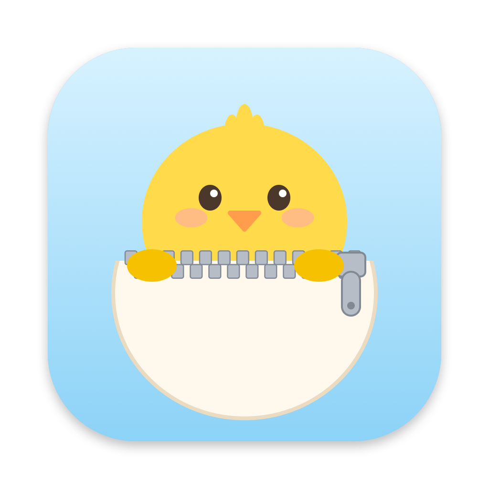

# 맥집 (MacZip)



맥에서 압축한 파일을 윈도우 쓰는 사람한테 보내면 한글 파일명이 전부 깨져서 도착하는 게 너무 불편해서 만든 압축 프로그램이에요. 맥 기본 압축 기능으로는 비밀번호도 걸 수 없다는 점도 아쉬웠고요.

그래서 맥집은 두 가지에 집중했습니다.

- 윈도우에서 열어도 한글 파일명이 깨지지 않는 zip 만들기
- 압축할 때 비밀번호 걸기 (AES-256 또는 ZipCrypto)

반대로 윈도우에서 만든 zip을 맥에서 풀 때 이름이 깨지는 문제도 알아서 처리해 줍니다(CP949 자동 판별). zip 말고 다른 형식은 지원하지 않아요.

## 설치

[최신 버전 dmg 받기](https://github.com/mindul/MacZip/releases/latest/download/MacZip.dmg) — 예전 버전은 [릴리스 목록](https://github.com/mindul/MacZip/releases)에 있어요.

dmg를 열고 맥집을 Applications 폴더로 옮기면 끝입니다. macOS 14 이상이면 Apple Silicon이든 Intel이든 다 돌아가요.

처음 실행할 때 "확인되지 않은 개발자"라는 경고가 뜰 거예요. 애플 개발자 서명을 하지 않아서 그렇습니다. 맥집을 우클릭해서 '열기'를 누르고, 경고 창에서 한 번 더 '열기'를 누르면 돼요. 한 번만 허용해 두면 다음부터는 그냥 열립니다.

## 쓰는 법

### 압축하기

방법은 세 가지예요. 편한 걸 쓰면 됩니다.

1. 파일이나 폴더를 맥집 창에 끌어다 놓기
2. 창을 클릭해서 파일 선택 창에서 고르기 (파일, 폴더 섞어서 여러 개 골라도 돼요)
3. Finder에서 파일을 우클릭하고 메뉴 맨 아래 "맥집에서 압축하기" 누르기 (여러 개 선택해도 되고, .zip 파일을 골라도 풀지 않고 압축해요)

그러면 "압축하기: N개 항목"이 뜨고 비밀번호 칸이 나옵니다. 비밀번호 없이 압축할 거면 그냥 [압축]을 누르면 되고, 비밀번호를 걸 거면 두 칸에 똑같이 입력하세요. 두 칸이 다르면 압축 버튼이 눌리지 않아요.

비밀번호를 입력하면 그 아래에 암호 방식을 고르는 항목이 나타납니다.

- AES-256 (기본값): 훨씬 안전해요. 대신 받는 사람이 반디집, 7-Zip, WinRAR 같은 압축 프로그램으로 열어야 합니다. 윈도우 탐색기로는 안 열릴 수 있어요.
- ZipCrypto: 윈도우 탐색기에서 더블클릭만으로 열려요. 대신 암호가 약해서 중요한 파일에는 권하지 않습니다.

받는 사람이 압축 프로그램을 쓰는지 잘 모르겠으면 ZipCrypto로, 아니면 AES-256으로 보내면 됩니다. 한 번 고른 방식은 앱을 끌 때까지 그대로 유지돼요.

비밀번호에는 영어, 숫자, 키보드 기호만 쓸 수 있어요. 한글 비밀번호는 윈도우 프로그램마다 처리하는 방식이 달라서 상대방이 못 여는 일이 생기거든요. 그래서 비밀번호 칸을 누르면 한글 자판이 자동으로 영문(ABC)으로 바뀌고, 칸에서 나오면 원래 자판으로 돌아옵니다.

압축 파일은 원본이 있던 폴더에 생겨요. 하나만 압축하면 `원래이름.zip`, 여러 개를 압축하면 `archive.zip`입니다. 같은 이름의 파일이 이미 있으면 덮어쓰지 않고 `archive 2.zip`처럼 번호를 붙여요. `.DS_Store`나 `__MACOSX` 같은 맥 전용 파일은 알아서 빼고 압축합니다.

### 압축 풀기

Finder에서 zip 파일을 우클릭하고 "맥집에서 압축 풀기"를 누르거나, "다음으로 열기"에서 "맥집"을 고르면 됩니다. 이렇게 풀 때는 맥집 창이 뜨지 않고 바로 풀려요. 비밀번호가 걸려 있으면 비밀번호 입력 창만 잠깐 뜨고, 틀리면 다시 물어봅니다. 맥집이 꺼져 있었다면 다 풀고 나서 저절로 종료돼요.

1초 넘게 걸리면 작은 진행 창이 떠요. 여기서 [취소]를 누르면 풀던 zip과 기다리던 zip이 모두 멈추고, 반쯤 풀린 폴더는 남지 않습니다. zip을 여러 개 골라도 차례대로 다 풀어 줍니다. "맥집에서 압축 풀기" 메뉴는 zip 파일에서만 보여요. zip 파일을 더블클릭했을 때 여는 기본 앱은 그대로(아카이브 유틸리티) 두었으니, 맥집으로 바로 열고 싶으면 zip 파일 정보 가져오기에서 "다음으로 열기"를 맥집으로 바꾸면 됩니다.

맥집 창에 zip 파일을 끌어다 놓아도 풀립니다. 이때는 창에서 진행 상황을 볼 수 있어요.

zip이 있던 폴더에 zip 이름으로 된 폴더가 하나 생기고 그 안에 풀려요. 반디집이나 7-Zip으로 만든 AES 암호 zip도 풀 수 있습니다.

인터넷에서 받은 zip을 풀면, 풀린 파일에도 "인터넷에서 받은 파일" 표시가 그대로 따라갑니다. 그래서 안에 든 앱이나 스크립트를 처음 열 때 macOS가 평소처럼 확인 창을 띄워요. 아카이브 유틸리티와 같은 동작입니다.

### 우클릭 메뉴가 안 보일 때

설치만 하고 맥집을 한 번도 안 켰다면 한 번 실행해 보세요. 그래도 안 보이면 시스템 설정 → 키보드 → 키보드 단축키 → 서비스 → "파일 및 폴더"에서 "맥집에서 압축하기"와 "맥집에서 압축 풀기"를 체크하면 됩니다. 메뉴 이름이 예전 것으로 남아 있으면 Finder를 다시 시작해 보세요(Option 키를 누른 채 Dock의 Finder 아이콘 우클릭 → 다시 실행).

## 안 되는 것

- zip만 됩니다. 7z, rar 같은 건 못 풀어요.
- 4GB가 넘는 파일은 지원하지 않습니다.
- 심볼릭 링크는 압축하는 폴더 안을 가리키는 것만 그대로 담고 풉니다(앱 안의 `Versions/Current` 같은 링크). 폴더 밖이나 절대 경로(`/etc/...`)를 가리키는 링크는 건너뛰어요.

## 직접 빌드하기

Xcode 없이 Command Line Tools만 있으면 됩니다.

```bash
swift build              # 빌드
swift run MacZipApp      # 앱 실행
swift run MacZipChecks   # 전체 테스트
```

이 환경에서는 XCTest를 쓸 수 없어서, 테스트는 `MacZipChecks`라는 실행 파일로 돌려요. 뒤에 이름 일부를 붙이면 그 테스트만 돌아갑니다(`swift run MacZipChecks ZipReader`). `--big`을 붙이면 400MB짜리 메모리 테스트까지 같이 도는데, 시간이 좀 걸려요.

`MACZIP_SELFTEST=1 swift run MacZipApp`으로 실행하면 실제 앱 코드로 파일 선택 → 비밀번호 입력 → 끌어다 놓기 흐름을 한 번 돌려 보고 바로 종료합니다. 예전에 이 과정에서 앱이 튕기는 버그가 있었어서 넣어 둔 점검이에요.

설치 파일은 이렇게 만듭니다.

```bash
./scripts/make-dmg.sh    # build/MacZip.dmg
```

안에서 `make-app.sh`가 Apple Silicon과 Intel을 함께 지원하는 앱을 만드는데, 위의 자체 점검을 두 아키텍처에서 모두 통과해야 dmg까지 만들어져요. 아이콘을 바꾸고 싶으면 `scripts/icon/AppIcon.swift`를 고친 다음 `./scripts/make-icon.sh`를 실행하면 됩니다.

설계 문서와 구현 계획은 `docs/superpowers/` 아래에 있어요.

## 릴리스 전에 직접 확인하는 것

자동 테스트로는 못 보는 부분이라 새 버전을 올리기 전에 손으로 한 번씩 확인합니다.

맥에서

- [ ] 파일 하나를 끌어다 놓고 [압축] → `파일이름.zip`이 생기고 [Finder에서 보기]가 동작하는지
- [ ] Finder에서 파일 우클릭 → "맥집에서 압축하기" → 창이 뜨고 "압축하기: 1개 항목"이 나오는지 (앱이 꺼져 있을 때, 켜져 있을 때 둘 다)
- [ ] .zip 파일 우클릭 → "맥집에서 압축하기" → 풀리지 않고 "압축하기: 1개 항목"이 나오는지
- [ ] .zip 파일 우클릭 → "맥집에서 압축 풀기" → 맥집 창 없이 같은 폴더에 풀리는지 (암호 zip이면 비밀번호 창만 뜨는지), 일반 파일에는 이 메뉴가 안 보이는지
- [ ] .zip 파일 우클릭 → "다음으로 열기"에 맥집이 한 번만 보이고, 고르면 창 없이 풀리는지 (기본 앱은 그대로인지)
- [ ] 맥집이 꺼진 상태에서 위 두 방법으로 풀면, 다 푼 뒤 맥집이 저절로 종료되는지
- [ ] 큰 zip(수백 MB)을 우클릭으로 풀면 1초쯤 뒤 진행 창이 뜨고, [취소]를 누르면 멈추고 반쯤 풀린 폴더가 남지 않는지
- [ ] 앱(.app)이 든 폴더를 맥집으로 압축하고, 그 zip을 맥집으로 풀었을 때 앱이 실행되는지
- [ ] 브라우저로 받은 zip(안에 `.command` 스크립트나 앱이 든 것)을 맥집으로 풀고 열면 "인터넷에서 다운로드" 확인 창이 뜨는지 (`xattr -l 풀린파일`에 `com.apple.quarantine`이 있는지)
- [ ] 창 클릭 → 파일과 폴더를 여러 개 골라 압축 → `archive.zip`이 생기는지
- [ ] 한글 자판 상태에서 비밀번호 칸 클릭 → 메뉴 막대 입력 소스가 ABC로 바뀌고, 칸을 벗어나면 한글로 돌아오는지
- [ ] 비밀번호 칸에 한글이 입력되지 않고 "영문·숫자·기호만" 안내가 뜨는지
- [ ] 비밀번호 두 칸을 다르게 넣으면 "비밀번호가 서로 다릅니다."가 뜨고 [압축]이 꺼지는지
- [ ] AES-256과 ZipCrypto 각각으로 비밀번호 zip을 만들고, 맥집으로 다시 풀리는지 (틀린 비밀번호면 "비밀번호가 맞지 않습니다.")
- [ ] 큰 폴더를 압축하다 [취소] → 만들다 만 zip이 남지 않는지
- [ ] 압축하는 동안 창이 멈추지 않고 진행 막대가 움직이는지

윈도우에서 (PC나 VM)

- [ ] 한글 파일명, 폴더명이 든 zip을 탐색기와 반디집(또는 7-Zip)으로 열었을 때 이름이 안 깨지는지
- [ ] ZipCrypto 비밀번호 zip이 탐색기와 반디집에서 모두 풀리는지
- [ ] AES-256 비밀번호 zip이 반디집이나 7-Zip에서 풀리는지
- [ ] `.DS_Store`, `__MACOSX` 같은 파일이 zip 안에 안 보이는지
- [ ] 윈도우에서 한글 이름으로 만든 zip을 맥으로 가져와 맥집으로 풀었을 때 이름이 안 깨지는지
